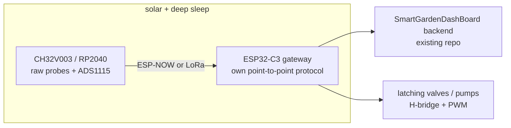

# Hardware Research: Bare-Metal Customizable Garden System

Goal: hardware where **we** own every layer — public datasheets, open toolchains, our own drivers, our own calibration procedures. No locked firmware. Researched 2026-10-12 (web research; verify part numbers/prices before ordering).

## 1. MCU / SoC Shortlist

| Hardware | Datasheet | Open SDK | Price | Verdict |
|---|---|---|---|---|
| **RP2040** | Full TRM public | pico-sdk (C/Rust), embedded-hal | $5–10 | **Best all-rounder.** Dual-core, 265 kB RAM, fully documented PIO state machines (bit-bang custom protocols in silicon), huge community |
| **RP2350** | Full datasheet | pico-sdk, PIO2 | $15–20 | RP2040++ — more RAM/flash, same PIO freedom |
| **ESP32-C3 / C6** | Full TRM | esp-rs (Rust), esp-idf | $6–12 | Wi-Fi RISC-V, ideal for dashboard nodes; some proprietary blobs in IDF |
| **CH32V003** | Public | ch32-rs Rust HAL | $1–8 | 10-cent-class RISC-V for dumb sensor nodes; 16 kB flash limits |
| **GD32VF103** | Public | gd32vf103xx-hal | $3–8 | Cheap RISC-V STM32F103 clone, mature Rust HAL |
| Pine64 Ox64 (BL808) | Public RM | NuttX/Linux, immature | $15–30 | Interesting, toolchain not ready |
| Sipeed K210 | Public | Mixed/proprietary Xtensa | $5–12 | Only if camera/vision needed |
| BeagleV-Ahead | Public | Linux/Zephyr | $50–80 | Overkill for nodes |

**Recommendation**: ESP32-C3/C6 for Wi-Fi dashboard nodes (you already know ESP32; the C-series is RISC-V with a full TRM), RP2040 for dense custom-protocol sensor work (PIO), CH32V003 for $2 distributed leaf nodes. Rust `embedded-hal` works across all three, so drivers port.

## 2. Sensors — Raw ICs We Calibrate Ourselves

| Measurement | Part | Interface | Our calibration work | Price |
|---|---|---|---|---|
| Soil moisture | Bare capacitive PCB probe / Watermark gypsum block | Analog | Dry-air + saturated references, soil-specific curve fit (5-pt) | $0.50–15 |
| Soil temp | DS18B20 (1-Wire) / PT1000 + MAX31865 (SPI) | 1-Wire/SPI | DS18B20 per-ROM offset; MAX31865: Callendar–Van Dusen from raw RTD register, lead-resistance correction | $1–15 |
| EC / salinity / NPK | Raw 2/4-probe EC cell + **ADS1115** (16-bit I2C ADC) | Analog→I2C | Excitation waveform, temp compensation (β≈2.1%/°C), 2–4 pt standards; 4-probe kills polarization; nitrate via ISE membranes (slow, minutes) | $15–40 |
| pH | Raw glass electrode + ADS1115 high-Z front end | Analog→I2C | Our own temp compensation; 2-pt (pH 4/7) or 3-pt buffer calibration | $10–25 |
| Air T/RH/P | SHT41/SHT45, BME280 | I2C | Factory-calibrated but raw-register drivers are ours; still verify against references | $5–15 |
| CO₂ | SCD40/SCD41 (true NDIR) | I2C | Forced-recalibration baseline, warm-up handling; avoid MH-Z19 ABC drift | $10–25 |
| Light / PAR | TSL2591 (broadband), AS7341 (11-ch spectral) | I2C | Own lux→PPFD conversion, saturation/clipping handling | $6–15 |
| Water level/flow | JSN-SR04T ultrasonic, YF-S201 hall flow | Pulse/analog | Temperature-compensated echo timing; pulse-count→L/min curve | $3–12 |

Key pattern: **ADS1115 + raw probe** beats any "smart" NPK gadget module — the cheap "NPK 5-in-1" modules on AliExpress are untrustworthy black boxes. A real nutrient workflow: EC probe + ISE nitrate electrode + temp compensation, all computed in our firmware.

## 3. Power

- **Solar MPPT**: raw ICs CN3722 (~$3–8) or LT3652 ($4–10) — analog config via resistors, no firmware to trust; or **LibreSolar MPPT-1210** ($25–40), fully open-source controller.
- **BMS**: LibreSolar BMS C1 or stuartpittaway/diyBMSv4 (open, ESP32 monitoring). LiFePO4 2–4s packs.
- **Deep sleep budget**: ESP32 deep sleep ~10–50 µA with peripherals; ULP coprocessor can poll ADC sensors at ~1–2 µA while the main core sleeps. 18650 (3.7 Wh) → months per node at sensible duty cycles.

## 4. Connectivity (node → dashboard)

- **ESP-NOW**: free on existing ESP32s, 100 m–1 km long-range mode, self-organizing, no gateway. Best default.
- **LoRa SX1262/SX1276** ($3–12/module): 2–5 km line-of-sight; own point-to-point protocol or ChirpStack self-hosted (avoid TTN dependency if we want full ownership).
- **RS485 + MAX485** ($5–10): for buried irrigation runs, 100 m–1 km, EMI-immune, daisy-chain.
- nRF24L01+ ($2–5): only for short cheap bursts; 2.4 GHz crowded.

## 5. Actuators

- **Latching 12 V solenoid valves** ($15–50): polarity-reversal H-bridge (dual N/P MOSFETs, ~$1 each) — no holding current, ideal for solar nodes. Flyback/TVS diode mandatory.
- **Peristaltic pumps** ($10–30): single N-channel MOSFET + PWM for dosing/fertigation speed control.
- Relays vs MOSFETs: relays for one-shot high-power, MOSFETs for anything PWM'd.

## 6. Open Reference Projects

- **OpenSprinkler** (and V1pr ESP32 port) — latching valve scheduling architecture.
- **LibreSolar** — open MPPT + BMS.
- **ESPHome / Tasmota** — read for driver architecture patterns, but the point here is writing bare-metal ourselves.

## Suggested Architecture

## Next Steps

1. Order a dev pack: 2× ESP32-C3 SuperMini, 1× Pico 2, 10× CH32V003, ADS1115, SHT41, capacitive probes, one latching valve + H-bridge (~$60 total).
2. Prototype: one leaf node with deep sleep + ULP sensor polling, reporting via ESP-NOW to the existing backend.
3. Then add EC/pH probe front ends and write our own calibration routines against buffer/standard solutions.
