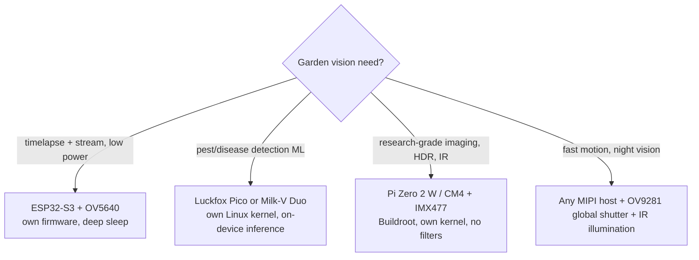

# Best Cameras (Own-OS / Own-Firmware)

All options below let **us** run our own kernel/OS/firmware — no locked consumer camera stack. Researched 2026-10-12; verify prices/availability before ordering.

## Shortlist

| Platform | Class | CPU | Camera interface | Toolchain | Price | Driver freedom |
|---|---|---|---|---|---|---|
| **ESP32-S3** | MCU | Xtensa LX7 | DVP (OV2640/OV5640) | ESP-IDF / esp-rs | $12–25 | **Full** — open esp32-camera driver, registers documented; Wi-Fi onboard |
| **RP2350** | MCU | dual-core | DVP via PIO (HM01B0/OV2640) | pico-sdk | $10–20 | **Full** — PIO does camera DMA with zero CPU cost; 512 kB RAM limit |
| **Luckfox Pico** (RV1106) | Linux | ARM A7 + RISC-V | CSI/DVP | Buildroot / mainline | $15–30 | **Full** — own kernel; onboard ISP |
| **Milk-V Duo** (SG2000/CV1800B) | Linux RISC-V | dual RISC-V + TPU | MIPI | Buildroot/Yocto | $25–45 | **Full** — RISC-V Linux, own kernel |
| **Raspberry Pi Zero 2 W / CM4** | Linux ARM | BCM | MIPI (IMX219/477/708) | Buildroot/Yocto, own kernel | $15–80 | **Full** — libcamera, mainline drivers; gold standard |
| **VisionFive 2** (JH7110) | Linux RISC-V | quad RISC-V | MIPI | mainline 6.8+ | $50–80 | **Full**; NPU for on-device vision |
| Sipeed Maix K210 | MCU | RISC-V KV260 | DVP | MaixPy | $8–15 | **Partial** — ISP functions are binary blobs |
| BeagleBone AI / Orange Pi 5 | Linux | TI/RK3588 | MIPI | mainline | $40–100 | Full but overkill |

## Raw image sensors

| Sensor | MP | Interface | Notes |
|---|---|---|---|
| **OV2640** | 2 | DVP | The default ESP32 camera; fully documented, ~$3 |
| **OV5640** | 5 | DVP | Better optics/fps than OV2640, still DVP; documented |
| **IMX219** | 8 | MIPI CSI | Pi Cam V2; mainline driver; global-shutter variant exists |
| **IMX477** | 12.3 | MIPI CSI | Pi HQ cam; best optics in this class; ~$50 |
| **IMX708** | 11.9 | MIPI CSI | Pi Cam V3, HDR, PDAF; rolling shutter |
| **OV9281** | 1 | MIPI | **Global shutter** mono — best for fast pest detection / IR |

## Recommendation by use case

- **Night/IR**: IMX477 + external 850 nm IR LEDs works (remove IR filter); OV9281 mono is natively IR-sensitive.
- **Power**: ESP32-S3 + OV5640 can deep-sleep between frames; Linux boards can't — for solar nodes prefer MCU class, or Luckfox with aggressive suspend.

## Top 3 overall
1. **ESP32-S3 + OV5640** — cheapest full-control vision node, own firmware end-to-end.
2. **Luckfox Pico (RV1106)** — $20 own-kernel Linux camera with onboard ISP; the sweet spot for on-device ML.
3. **Pi Zero 2 W + IMX477** — when image quality matters more than power.

See also: [README.md](README.md), [sensors.md](sensors.md).
